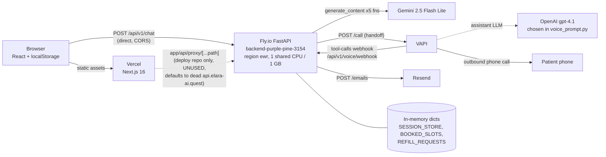
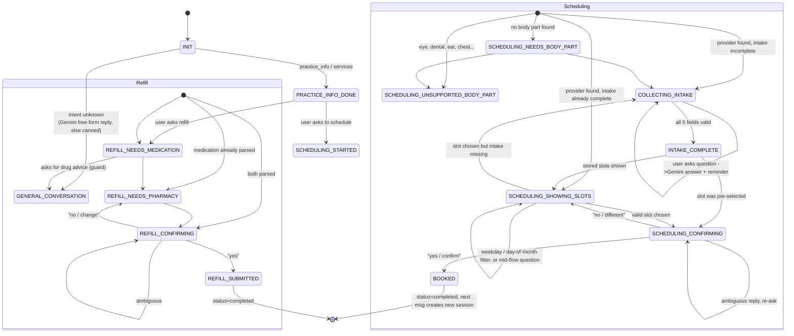

# Elara.ai — Architecture

Snapshot of the code at `main` @ `53186f9`, plus the Vercel deploy repo `AmaanIlahi/Elara.ai_frontend` @ `c6c32ee`.
Everything below is read from code; items I could not verify from the repos (Vercel/Fly dashboard settings, Fly secrets) are marked **(unverified)**.

---

## 1. Request flow

**The README and the original brief describe a Next.js proxy hop. That is no longer how the code works.**
The proxy route (`app/api/proxy/[...path]/route.ts`) exists only in the deploy repo, and since commit `db23fb8` (2026-04-04) `lib/api.ts` no longer calls it.
Today the browser calls the Fly.io backend **directly** at `NEXT_PUBLIC_API_BASE_URL`, and the backend's CORS allow-list is what makes that work.



Key facts:

| Hop | Detail | Source |
|---|---|---|
| Browser -> backend base URL | `process.env.NEXT_PUBLIC_API_BASE_URL \|\| "http://localhost:8000"`. Inlined at **build** time, so a wrong/missing Vercel env var silently targets localhost. | `frontend/lib/api.ts:43-44` |
| Browser calls | `POST /api/v1/chat`, `POST /api/v1/voice/handoff`, `POST /api/v1/send-confirmation-email` | `frontend/lib/api.ts:75,106,128` |
| Dead proxy | `BACKEND_URL \|\| "https://api.elara-ai.quest"`. That Cloudflare-tunnel hostname did not connect when I tested it (curl code 000). | deploy repo `app/api/proxy/[...path]/route.ts:3` |
| Legacy local route | `app/api/schedule` runs the old client-side mock matcher (`lib/conversation.ts`). Only `submitSchedulingRequest` in `api.ts` calls it, and nothing calls that. | `frontend/app/api/schedule/route.ts` |
| Backend -> Gemini | `google-genai` SDK, synchronous `generate_content` | `backend/app/services/llm_service.py` |
| Backend -> VAPI | `httpx` POST `https://api.vapi.ai/call` with an inline assistant definition; VAPI calls back `…/voice/webhook` | `backend/app/routes/voice.py:57-62` |
| Backend -> Resend | `requests` POST `https://api.resend.com/emails` (blocking call inside an `async` route) | `backend/app/services/email_service.py:550` |

---

## 2. Backend layout (`backend/app`)

```
main.py                  FastAPI app, CORS, request-log middleware, router wiring
core/config.py           pydantic-settings Settings (reads env + .env)
routes/                  HTTP layer
  chat.py (1332 lines)   POST /chat, POST /chat/stream  <- the orchestrator / state machine
  session.py             POST /session/create, GET /session/{id}
  booking.py             POST /scheduling/book
  scheduling.py          GET  /scheduling/availability?message=
  refill.py              POST /refill/submit
  practice.py            GET  /practice/info
  voice.py               POST /voice/handoff, POST /voice/webhook
  email.py               POST /send-confirmation-email, GET /ping
  health.py              GET  /health
services/
  session_service.py     in-memory SESSION_STORE
  nlu_service.py         LLM intent extraction + keyword fallback, confidence gate
  fallback_nlu.py        keyword NLU
  llm_service.py         the Gemini wrapper (5 functions)
  intake_service.py      field validation / DOB normalisation / sanitize_text
  scheduling_service.py  provider match, slot filtering, booking
  refill_service.py      refill parsing + submit
  practice_service.py    keyword-matched practice answers
  chat_service.py        keyword workflow detection + first-turn canned replies
  voice_prompt.py        builds the VAPI assistant payload
  voice_tools.py         VAPI tool executor (get_session_context, continue_scheduling)
  email_service.py       Resend call + HTML template
schemas/                 Pydantic models (below)
data/                    provider_data.py (4 providers, generated slots), practice_data.py, refill_data.py (empty list)
```

All routes are mounted under `/api/v1` (`settings.api_v1_prefix`), so the health URL is **`/api/v1/health`**, not `/health`. `/` returns a welcome JSON. OpenAPI/docs are disabled (`docs_url=None`, `redoc_url=None`, `openapi_url=None`).

### 2.1 Endpoints

| Method + path | Request model | Purpose |
|---|---|---|
| `POST /api/v1/chat` | `ChatRequest` -> `ChatResponse` | Main turn handler. Rate limit `20/minute` per remote address. |
| `POST /api/v1/chat/stream` | `ChatRequest` | Calls `handle_chat`, then replays the finished text word-by-word over SSE (fake streaming, 30 ms/word). The frontend does not use it. |
| `POST /api/v1/session/create` | none | Create empty session. Frontend never calls it; `/chat` creates sessions lazily. |
| `GET /api/v1/session/{id}` | | Returns the whole `Session` including collected PHI. No auth. |
| `POST /api/v1/scheduling/book` | `BookingRequest{session_id, slot_choice}` | Direct booking, bypasses the confirm step. Not called by the frontend. |
| `GET /api/v1/scheduling/availability` | query `message` | Debug-style slot lookup. |
| `POST /api/v1/refill/submit` | `RefillSubmitRequest` | Direct refill submit. Not called by the frontend. |
| `GET /api/v1/practice/info` | | Returns `PRACTICE_INFO` dict. |
| `POST /api/v1/voice/handoff` | `VoiceHandoffRequest{session_id}` -> `VoiceHandoffResponse` | Starts a VAPI outbound call to `"+1" + phone_number`. 404 if the session is gone, 400 if no phone yet. |
| `POST /api/v1/voice/webhook` | raw JSON | VAPI server URL. Handles `tool-calls`; acks other message types. **No signature or secret check.** |
| `POST /api/v1/send-confirmation-email` | `BookingEmailRequest{session_id}` | Sends booking email once (`confirmation_email_sent` flag). |
| `GET /api/v1/ping`, `GET /api/v1/health` | | Liveness. |

### 2.2 Pydantic models

| Model | File | Fields |
|---|---|---|
| `Session` | `schemas/session.py` | `session_id` (uuid4 str), `phone_number`, `first_name`, `last_name`, `dob`, `email`, `workflow_type`, `state="INIT"`, `collected_data: dict`, `last_message`, `status="in_progress"`, `created_at`, `updated_at` |
| `ChatRequest` | `schemas/chat.py` | `message`, `session_id?`, `phone_number?` |
| `ChatResponse` | `schemas/chat.py` | `session_id`, `workflow_type?`, `state`, `message`, `next_step?`, `metadata: dict`, `quick_replies: list[QuickReply{id,label,value}]` |
| `BookingRequest` | `schemas/booking.py` | `session_id`, `slot_choice:int` |
| `RefillSubmitRequest` | `schemas/refill.py` | `session_id`, `medication_name`, `pharmacy_name`, `pharmacy_phone?`, `notes?` |
| `BookingEmailRequest` | `schemas/email.py` | `session_id` |
| `VoiceHandoffRequest/Response`, `VapiToolResult`, `VapiWebhookResponse`, `SessionContextResponse` | `schemas/voice.py` | `VoiceHandoff*` are used; the other three are defined but never referenced. |
| `LLMExtractionResult` | `services/llm_service.py` | `intent, body_part, reason, requested_day, requested_time_pref, refill_medication, practice_info_topic, confidence, needs_clarification` — also passed to Gemini as `response_schema`. |

### 2.3 State storage

* **Sessions**: a module-level `SESSION_STORE: Dict[str, Session]` in `services/session_service.py`. Key = `session_id`, a random uuid4 minted by the server. There is no user identity, TTL, eviction, locking or persistence.
* **Almost all workflow state lives in `Session.collected_data`** (an untyped dict): `history` (list of `{role, content}`, unbounded), `pending_intake_field`, `slots`, `selected_slot`, `pending_slot_choice`, `provider_id/name`, `specialty`, `body_part`, `booked_slot`, `booking_confirmed`, `medication_name`, `pharmacy_name`, `last_nlu`, `confirmation_email_sent`, plus the intake fields (also mirrored onto `Session.first_name` etc.).
* **Booked slots**: global `BOOKED_SLOTS: Set[str]` (`"provider|date|time"`) in `data/provider_data.py`. **Refill requests**: global list `REFILL_REQUESTS`. Both are process-local and shared by all sessions.
* **Consequence**: any process restart (deploy, crash, or a Fly auto-stop) erases every session, booking and refill. The browser keeps its old `session_id` in localStorage, and `/chat` then answers `404 "Session not found"` (`routes/chat.py:207-210`). See ANALYSIS.md, Bug 1.
* A session whose `status == "completed"` (set on booking or refill submit) is replaced by a fresh one on the next `/chat` call (`chat.py:215-216`). The response carries the new `session_id`.

### 2.4 Browser-side state (`frontend/lib/session.ts`, `components/chat/ChatShell.tsx`)

`localStorage` keys `elara_session_id`, `elara_chat_messages`, `elara_chat_meta`. Written on every change, read on mount, cleared only by the "New chat" button (`handleReset`). No cookies and no sessionStorage.

---

## 3. Conversation state machine

State names are strings set in `routes/chat.py`, `scheduling_service.py`, `refill_service.py`, `intake_service.py` and `chat_service.py`. `workflow_type` is re-derived on **every** turn (`chat.py:583-600`), so the user can switch workflow mid-conversation; only `practice_info` and `unknown` are treated as single-turn.



### 3.1 Per-workflow notes

**Turn pipeline (`handle_chat`, `routes/chat.py:197`)**
1. `sanitize_text` on input (strips tags/NULs, collapses whitespace).
2. Look up the session. If `session_id` is supplied but unknown, **404**. If absent, create one. If `status == "completed"`, create a new one.
3. `NLUService.extract` (Gemini function 1, or keyword fallback).
4. **If `pending_intake_field` is set**, the intake branch runs first and returns early: question detection, then Gemini multi-field extraction, then single-field regex (`continue_intake_flow`).
5. Otherwise route by `workflow_type`: `services`, `practice_info`, `scheduling`, `refill`, else general.
6. Append to `collected_data["history"]`, optionally run `_maybe_polish_reply` (Gemini function 2), return `ChatResponse` with `quick_replies` from `_build_quick_replies`.

**Scheduling**
* Provider matching is a deterministic substring match of body part against 4 hard-coded providers (`data/provider_data.py`). Slots are generated at import time for the next 45 days.
* Intake (first name, last name, DOB, phone, email) is collected before slots are shown. Gemini can fill several fields from one message, and each value is re-validated by `extract_field_value`.
* A slot can be chosen by number, time ("9am"), relative phrase ("early one"), weekday, or day of month.
* Booking always goes through `SCHEDULING_CONFIRMING`. Confirmation is a substring test for "yes/ok/sure/book/please…" against "no/change/back/another…". `confirm_booking_from_session_data` marks the slot booked **without first checking it is still free**.
* After `BOOKED`, `_maybe_append_booking_guidance` (Gemini function 4) appends prep tips. The frontend then calls `/send-confirmation-email`.

**Refills**
* `build_refill_response` and `continue_refill_flow` use string matching. Names longer than 5 words (medication) or 6 words (pharmacy) are rejected as conversational. Phrases like "recommend / what should I take" divert to `GENERAL_CONVERSATION`.
* Submission appends to the global `REFILL_REQUESTS` list and returns a uuid. **Refill does not collect the 5 intake fields** in the chat path (only the `/refill/submit` REST route checks them).

**Practice info**
* `answer_practice_question` keyword-matches hours / address / phone / email against `PRACTICE_INFO`. The `services` workflow lists providers. Both end in `PRACTICE_INFO_DONE` with quick replies to start scheduling or refill.

**Mid-flow Q&A**
* While in `COLLECTING_INTAKE` (a `pending_intake_field` exists): if the message contains "?" or starts with a question word, `generate_general_reply` (8 s wait_for) answers it and appends "To continue, <intake prompt>". State is unchanged.
* While in `SCHEDULING_SHOWING_SLOTS`: if the message is neither a slot choice nor a day filter, `generate_general_reply` answers and reminds the user to pick a slot.
* If Gemini is off or fails, the user gets a static "Just pick one of the slots above" / the intake error text.
* No mid-flow Q&A exists in `SCHEDULING_CONFIRMING` (ambiguous input just re-asks) or in the refill flow.

**Voice handoff**
* `/voice/handoff` requires `phone_number` in the session. It builds a VAPI assistant whose system prompt embeds `session_id`, `state` and **the whole `collected_data` dict**. The model is hard-coded to OpenAI `gpt-4.1` in VAPI. Two tools are exposed (`get_session_context`, `continue_scheduling`), both served by `/voice/webhook`.
* `continue_scheduling` re-implements a reduced version of the chat logic. Several branches call `update_session(..., {"collected_data": response["metadata"]})`, which **replaces** `collected_data` with only the new metadata. That wipes the patient's name, DOB, phone, email and history mid-call.

---

## 4. The Gemini functions and their fallbacks

The README says four. `llm_service.py` has **five**; the fifth (`generate_general_reply`) is undocumented. All five go through one `LLMService` class. Two instances exist (one inside `NLUService`, one at `chat.py:45`), so two `genai.Client`s are built at import time.

| # | Function (`services/llm_service.py`) | Called from | Output handling | Fallback trigger -> behaviour |
|---|---|---|---|---|
| 1 | `extract_structured_intent` (l.48) — temp 0, JSON mode, `response_schema=LLMExtractionResult` | `NLUService.extract` for **every** message (`chat.py:223`) | `response.parsed` (Pydantic-validated by the SDK). Low confidence (<0.55) with intent None/unknown sets `needs_clarification`. | Returns `None` when disabled, `parsed` is empty, or **any** exception (bare `except`, no logging). `NLUService` then runs `fallback_extract` (keyword rules, confidence 0.35). Note: it returns intent `"schedule"` and `_normalize_workflow` maps that to `scheduling`. |
| 2 | `generate_chat_reply` ("polish", l.129) — temp 0.4 | `_maybe_polish_reply` (`chat.py:158`) for states in `POLISHABLE_STATES`, skipped when `metadata.slots` exists | Free text, no validation | `None` on disabled/empty/exception, or `asyncio.TimeoutError` at 3 s -> original template message is returned. |
| 3 | `extract_intake_fields` (l.242) — temp 0, JSON mode, **no schema** | In the intake branch (`chat.py:274-283`) | `json.loads` -> dict -> each value re-validated by `extract_field_value`. Only the 5 whitelisted keys survive. | `None` on disabled/empty/non-dict/exception, or 5 s timeout -> falls through to one-field-at-a-time `continue_intake_flow`. |
| 4 | `generate_post_booking_guidance` (l.307) — temp 0.6 | `_maybe_append_booking_guidance` after `BOOKED` | Free text appended to the confirmation | `None`/exception/5 s timeout -> message sent without tips. |
| 5 | `generate_general_reply` (l.182) — temp 0.7 | unknown intent (8 s), mid-flow questions in intake and in slot selection (8 s) | Free text | `None`/exception/timeout -> canned `get_workflow_response` text or the "pick one of the slots" nudge. |

**Gating**: `LLMService.is_enabled()` is true only if `LLM_ENABLED=true` **and** `LLM_PROVIDER=gemini` **and** `GEMINI_API_KEY` is set (`llm_service.py:42`). `llm_enabled` defaults to **False** in `config.py`. `fly.toml` sets none of these, so on Fly they must exist as secrets/env or the app runs entirely on keyword fallbacks and nobody is told **(unverified)**. A startup `print` shows the state (`chat.py:46`).

**Caveats that affect how the fallbacks really behave**
* `client.models.generate_content` is the **synchronous** SDK call, invoked inside `async def`. It blocks the event loop for its full duration, and `asyncio.wait_for(..., timeout=N)` cannot interrupt a coroutine that never yields. The 3/5/8 s timeouts are therefore not enforced, and `llm_timeout_seconds` (config.py:100) is stored on the service but never used. A slow Gemini call stalls every other request on the single worker.
* There are no retries, no backoff, no output schema for functions 3-5, and no per-call logging of latency or token usage (a `latency_ms` is computed in function 1 and discarded).
* Voice does not use Gemini at all. VAPI runs `gpt-4.1`.

---

## 5. Configuration, secrets and deployment

### 5.1 Environment variables

Backend, read by `core/config.py` (pydantic-settings; env first, then `.env`; `extra="ignore"`):

| Variable | Default | Used for | Secret? |
|---|---|---|---|
| `APP_NAME`, `APP_VERSION` | "Elara AI Backend", "0.1.0" | FastAPI metadata | no |
| `DEBUG` | **True** | `FastAPI(debug=…)` | no |
| `FRONTEND_ORIGIN` | `http://localhost:3000` | **declared but never read**; CORS origins are hard-coded in `main.py:36-41` | no |
| `API_V1_PREFIX` | `/api/v1` | router prefix | no |
| `LLM_PROVIDER` / `LLM_ENABLED` | `gemini` / **False** | gate for Gemini | no |
| `GEMINI_API_KEY` | none | Gemini | **yes** |
| `GEMINI_MODEL` | `gemini-2.5-flash-lite` | model id | no |
| `LLM_TIMEOUT_SECONDS` | 15 | **unused** | no |
| `VAPI_API_KEY`, `VAPI_PHONE_NUMBER_ID` | none | outbound call | **yes** |
| `PUBLIC_BACKEND_BASE_URL` | `http://localhost:8000` | webhook URL given to VAPI. **Must be the Fly URL in prod or VAPI tool calls go to localhost** | no |
| `PUBLIC_FRONTEND_BASE_URL` | `http://localhost:3000` | **unused** | no |
| `VAPI_ASSISTANT_NAME` | "Elara Voice Scheduler" | assistant name | no |
| `RESEND_API_KEY` | none | email | **yes** |
| `RESEND_FROM_EMAIL` | `Elara <onboarding@resend.dev>` | sender; the default is Resend's sandbox sender, which only delivers to the account owner (the code treats a 403 as success, `email_service.py:569`) | no |
| `PORT` | set to `8000` in `fly.toml [env]` | Dockerfile CMD fallback | no |

Frontend:

| Variable | Where | Notes |
|---|---|---|
| `NEXT_PUBLIC_API_BASE_URL` | `lib/api.ts:44`; Docker `ARG` in `frontend/Dockerfile` | Public, build-time. Must be set in Vercel for Production **and** Preview. **(unverified)** |
| `BACKEND_URL` | deploy-repo proxy route only | dead code path |

No `.env*` file is committed in either repo (`.gitignore` covers `.env*` in the frontend; the backend has **no** `.gitignore` or `.dockerignore`, see ANALYSIS.md §7).

### 5.2 Backend container and Fly

`backend/Dockerfile`: `python:3.11-slim`, `pip install -r requirements.txt`, `COPY . .`, `CMD uvicorn app.main:app --host 0.0.0.0 --port ${PORT:-8000}`. Single stage, root user, no `.dockerignore`, no `HEALTHCHECK`, one uvicorn worker.

`backend/fly.toml`:

```toml
app = 'backend-purple-pine-3154'
primary_region = 'ewr'
[env]          PORT = "8000"
[http_service] internal_port = 8000, force_https = true,
               auto_stop_machines = 'stop', auto_start_machines = true,
               min_machines_running = 0, processes = ['app']
[processes]    app = "uvicorn app.main:app --host 0.0.0.0 --port 8000"   # overrides Dockerfile CMD
[[vm]]         shared cpu x1, 1 GB (memory = '1gb' and memory_mb = 1024 both present)
```

No `[[http_service.checks]]`, no `[deploy]` strategy, no secrets listed. The process command has no `--proxy-headers/--forwarded-allow-ips`, so `request.client.host` is probably Fly's proxy address, which breaks per-client rate limiting (inference; not tested).

`requirements.txt` is UTF-16 encoded (pip copes via BOM). Declared but never imported: `boto3, sqlalchemy, alembic, python-jose, passlib, bcrypt, aiohttp, email-validator, python-multipart`. Both `requests` (email) and `httpx` (VAPI) are used.

### 5.3 Frontend / Vercel

* Next 16.2.0, React 19.2.4, Tailwind 4. `next.config.ts` = `{ output: "standalone" }`, which is needed only by the Docker image. Commit `8b538e5` removed it as "incompatible with Vercel"; a later commit put it back. It is present in both repos today.
* No `vercel.json` in either repo. Vercel settings (project name, root directory, env vars, framework preset) are **(unverified)**; the live URL is `elara-ai-frontend-5hst.vercel.app`, which is in the backend's CORS list.
* `frontend/Dockerfile` (3-stage Node 20 alpine, standalone output, `ARG NEXT_PUBLIC_API_BASE_URL`) is a leftover from the EC2 deployment and is not used by Vercel.
* Backend CORS (`main.py:36-49`): `localhost:3000`, `127.0.0.1:3000`, `elara-ai-frontend.vercel.app`, `elara-ai-frontend-5hst.vercel.app`; credentials allowed; all methods/headers. Vercel preview deployments are not in the list, so previews cannot reach the API.
* `slowapi`: `main.py` creates a `Limiter` with `default_limits=["60/minute"]` and registers the 429 handler, but never adds `SlowAPIMiddleware`, so the default limit is likely not applied. `chat.py` creates a second `Limiter` and decorates only `/chat` and `/chat/stream` with `20/minute`.

### 5.4 Observability that exists

`main.py:52-57` prints `REQUEST: METHOD path` and `RESPONSE: status path` per request. About 22 other bare `print()` calls exist (Resend config/body, LLM errors, booking guidance). No structured logs, request IDs, metrics or tracing.
