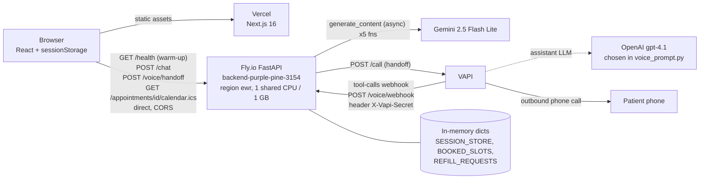
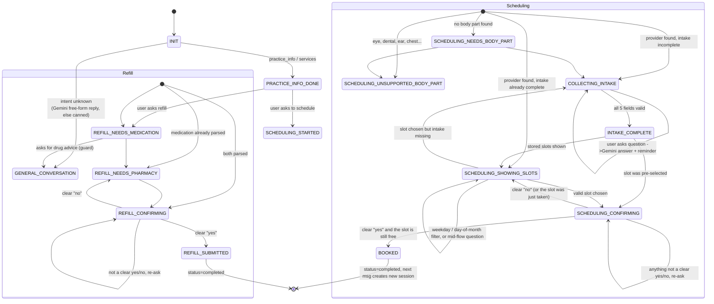

# Elara.ai — Architecture

Describes `main` after **Phase 0** (resilience, async Gemini, booking and voice fixes) and **Phase 0.5** (calendar instead of email, abuse protection, smaller PHI surface, demo-correctness fixes, cleanup).
The first version of this document and ANALYSIS.md were written against `53186f9`; places that changed since are called out as *(Phase 0)* or *(Phase 0.5)*.
Items I could not verify from the repo (Vercel/Fly dashboard settings, Fly secrets) are marked **(unverified)**.

---

## 1. Request flow

The browser calls the Fly.io backend **directly** at `NEXT_PUBLIC_API_BASE_URL`; the backend's CORS allow-list is what makes that work. There is no Next.js proxy hop (the old proxy route exists only in the separate `Elara.ai_frontend` deploy repo and is unused).



| Hop | Detail | Source |
|---|---|---|
| Browser -> backend base URL | `process.env.NEXT_PUBLIC_API_BASE_URL \|\| "http://localhost:8000"`. Inlined at **build** time, so the Vercel env var must be set before the build. | `frontend/lib/api.ts` |
| Browser calls | `GET /api/v1/health` on page load (wakes a stopped Fly machine), `POST /api/v1/chat`, `POST /api/v1/voice/handoff`, `GET /api/v1/appointments/{session_id}/calendar.ics` (the "Add to calendar" button). All go through `apiFetch`: 15 s timeout, 3 retries with exponential backoff on network errors and 502/503 *(Phase 0)*. | `frontend/lib/api.ts` |
| Backend -> Gemini | `google-genai`, `client.aio.models.generate_content` inside `asyncio.wait_for`, one shared client *(Phase 0)* | `backend/app/services/llm_service.py` |
| Backend -> VAPI | `httpx` POST `https://api.vapi.ai/call` with an inline assistant definition. VAPI calls back `…/voice/webhook` and must send the shared secret in `X-Vapi-Secret` *(Phase 0.5)* | `backend/app/routes/voice.py`, `voice_prompt.py` |
| Calendar file | Built with the standard library: `VEVENT` plus an embedded `America/New_York` `VTIMEZONE`, so no tz database or dependency is needed *(Phase 0.5)* | `backend/app/services/calendar_service.py` |
| Email | **Removed** *(Phase 0.5)*. There is no outbound email integration any more. | |

---

## 2. Backend layout (`backend/app`)

```
main.py                  FastAPI app, CORS, SlowAPIMiddleware, request-log middleware, router wiring
core/config.py           pydantic-settings Settings (reads env + .env), startup_summary()
core/limiter.py          the one shared slowapi Limiter, keyed on Fly-Client-IP
routes/                  HTTP layer
  chat.py                POST /chat  <- the orchestrator / state machine
  practice.py            GET  /practice/info
  voice.py               POST /voice/handoff, POST /voice/webhook
  appointments.py        GET  /appointments/{session_id}/calendar.ics
  health.py              GET  /health
services/
  session_service.py     in-memory SESSION_STORE, SessionExpired
  nlu_service.py         LLM intent extraction + keyword fallback, confidence gate
  fallback_nlu.py        keyword NLU
  llm_service.py         the Gemini wrapper (5 functions), async + timeouts, shared client
  intake_service.py      field validation / DOB normalisation (US-first) / US phone / sanitize_text
  confirmation.py        strict yes/no reading for the book/submit steps
  scheduling_service.py  provider match, slot filtering, atomic booking, conflict messages
  refill_service.py      refill parsing + submit
  practice_service.py    keyword-matched practice answers
  chat_service.py        keyword workflow detection + first-turn canned replies
  calendar_service.py    .ics builder
  voice_prompt.py        builds the VAPI assistant payload (incl. webhook secret)
  voice_tools.py         VAPI tool executor (get_session_context, continue_scheduling)
schemas/                 Pydantic models (below)
data/                    provider_data.py (4 providers, generated slots, BOOKED_SLOTS), practice_data.py, refill_data.py (empty list)
tests/                   pytest suite (163 tests)
```

All routes are mounted under `/api/v1` (`settings.api_v1_prefix`), so the health URL is **`/api/v1/health`**. `/` returns a welcome JSON. OpenAPI/docs are disabled (`docs_url=None`, `redoc_url=None`, `openapi_url=None`).

### 2.1 Endpoints

| Method + path | Request -> response | Purpose and protections |
|---|---|---|
| `POST /api/v1/chat` | `ChatRequest` -> `ChatResponse` | Main turn handler. **20/min per client.** `message` max 1000 chars (else 422). Unknown `session_id` -> `404 {"error":"session_expired"}`. |
| `GET /api/v1/practice/info` | | Returns `PRACTICE_INFO`. Default limit 60/min. |
| `GET /api/v1/appointments/{session_id}/calendar.ics` | | `text/calendar` attachment for a session whose state is `BOOKED`; 404 otherwise. Default limit. The `session_id` (uuid4) is the only credential. |
| `POST /api/v1/voice/handoff` | `VoiceHandoffRequest{session_id}` -> `VoiceHandoffResponse` | Starts a VAPI outbound call. **3/hour per client; at most one call per session** (`409` on a repeat). The phone must be a 10-digit US number (`400` otherwise) before `"+1"` is prepended. `500` if `VAPI_API_KEY`, `VAPI_PHONE_NUMBER_ID` or `VAPI_WEBHOOK_SECRET` is missing. |
| `POST /api/v1/voice/webhook` | raw JSON from VAPI | Handles `tool-calls`; acks other message types. **Requires `X-Vapi-Secret` equal to `VAPI_WEBHOOK_SECRET`**; `401` if missing or wrong, and always `401` when no secret is configured. Exempt from rate limiting (the secret is the gate). |
| `GET /api/v1/health` | | Liveness for Fly checks and the browser warm-up. Exempt from rate limiting and not logged. |
| `GET /` | | Welcome JSON. |

**Removed in Phase 0.5** (none were used by the frontend): `GET /session/{id}` (returned the whole session incl. PHI), `POST /session/create`, `POST /scheduling/book`, `POST /refill/submit`, `GET /scheduling/availability`, `POST /chat/stream`, `POST /send-confirmation-email`, `GET /ping`.

**Rate limiting.** One `Limiter` in `core/limiter.py`, key = `Fly-Client-IP` header, falling back to the socket address (Fly's proxy overwrites that header, so it cannot be spoofed from outside; locally there is no header). `SlowAPIMiddleware` is installed, but FastAPI 0.162 wraps routers added with `include_router` in an object slowapi's middleware cannot look into, so for those routes the middleware silently skips the default limit. Every router endpoint therefore carries `@default_limit` (60/min), its own limit, or `@limiter.exempt`; `tests/test_phi_surface.py` fails if one is missing. Counters are in process memory and reset on restart.

### 2.2 Pydantic models

| Model | File | Fields |
|---|---|---|
| `Session` | `schemas/session.py` | `session_id` (uuid4 str), `phone_number`, `first_name`, `last_name`, `dob`, `email`, `workflow_type`, `state="INIT"`, `collected_data: dict`, `last_message`, `status="in_progress"`, `voice_call_started=False`, `created_at`, `updated_at` |
| `ChatRequest` | `schemas/chat.py` | `message` (max 1000 chars), `session_id?`, `phone_number?` |
| `ChatResponse` | `schemas/chat.py` | `session_id`, `workflow_type?`, `state`, `message`, `next_step?`, `metadata: dict`, `quick_replies: list[QuickReply{id,label,value}]` |
| `VoiceHandoffRequest/Response` | `schemas/voice.py` | used by `/voice/handoff` |
| `VapiToolResult`, `VapiWebhookResponse`, `SessionContextResponse` | `schemas/voice.py` | defined but never referenced |
| `LLMExtractionResult` | `services/llm_service.py` | `intent, body_part, reason, requested_day, requested_time_pref, refill_medication, practice_info_topic, confidence, needs_clarification`; also passed to Gemini as `response_schema` |

### 2.3 State storage

* **Sessions**: a module-level `SESSION_STORE: Dict[str, Session]` in `services/session_service.py`. Key = `session_id`, a random uuid4 minted by the server. There is no user identity, TTL, eviction, locking or persistence.
* **Almost all workflow state lives in `Session.collected_data`** (an untyped dict): `history` (list of `{role, content}`, unbounded), `pending_intake_field`, `slots`, `selected_slot`, `pending_slot_choice`, `provider_id/name`, `specialty`, `body_part`, `booked_slot`, `booking_confirmed`, `medication_name`, `pharmacy_name`, `last_nlu`, plus the intake fields (also mirrored onto `Session.first_name` etc.).
* **Booked slots**: global `BOOKED_SLOTS: Set[str]` (`"provider|date|time"`) in `data/provider_data.py`, claimed atomically by `try_mark_slot_booked` *(Phase 0)*. **Refill requests**: global list `REFILL_REQUESTS`. Both are process-local and shared by all sessions.
* **Consequence**: any process restart (deploy, crash, or a Fly auto-stop) erases every session, booking and refill, and with them any calendar link. The browser's stored `session_id` then gets `404 {"error":"session_expired"}`, which the frontend turns into a fresh session plus a notice *(Phase 0)*.
* A session whose `status == "completed"` (set on booking or refill submit) is replaced by a fresh one on the next `/chat` call. The completed session itself stays in memory, which is why its `.ics` still works afterwards.

### 2.4 Browser-side state (`frontend/lib/session.ts`, `components/chat/ChatShell.tsx`)

`sessionStorage` keys `elara_session_id`, `elara_chat_messages`, `elara_chat_meta` *(Phase 0: was localStorage)*. A refresh keeps the chat; a new tab or browser session starts clean. Cleared by "New chat" and on `session_expired`. "Continue on phone" is enabled only after a successful `/chat` response in the current page load. The booking card stores the `session_id` it needs for "Add to calendar".

---

## 3. Conversation state machine

State names are strings set in `routes/chat.py`, `scheduling_service.py`, `refill_service.py`, `intake_service.py` and `chat_service.py`. `workflow_type` is re-derived on **every** turn, so the user can switch workflow mid-conversation; only `practice_info` and `unknown` are treated as single-turn.



### 3.1 Per-workflow notes

**Turn pipeline (`handle_chat`, `routes/chat.py`)**
1. `sanitize_text` on input (strips tags/NULs, collapses whitespace). The request model already rejected messages over 1000 characters.
2. Look up the session. If `session_id` is supplied but unknown, raise `SessionExpired` (404 `session_expired`). If absent, create one. If `status == "completed"`, create a new one.
3. `NLUService.extract` (Gemini function 1, or keyword fallback).
4. **If `pending_intake_field` is set**, the intake branch runs first and returns early: question detection, then Gemini multi-field extraction, then single-field regex (`continue_intake_flow`).
5. Otherwise route by `workflow_type`: `services`, `practice_info`, `scheduling`, `refill`, else general.
6. Append to `collected_data["history"]`, optionally run `_maybe_polish_reply` (Gemini function 2), return `ChatResponse` with `quick_replies` from `_build_quick_replies`.

**Scheduling**
* Provider matching is a deterministic substring match of body part against 4 hard-coded providers (`data/provider_data.py`). Slots are generated at import time for the next 45 days.
* Intake (first name, last name, DOB, phone, email) is collected before slots are shown. Gemini can fill several fields from one message, and each value is re-validated by `extract_field_value`. **DOB**: slash and dash dates are read US-first (`03/04/1990` = March 4); day-first is only a fallback for values MM/DD cannot represent; future dates and ages over 120 are rejected *(Phase 0.5)*.
* A slot can be chosen by number, time ("9am"), relative phrase ("early one"), weekday, or day of month.
* Booking always goes through `SCHEDULING_CONFIRMING`. The reply is read by `services/confirmation.py` *(Phase 0.5)*: it is a yes or a no only if **every word** is a known yes/no word or neutral filler. "yes", "yes please", "no" work; "not sure", "no thanks", "no thanks, yes" and anything with extra words re-ask, and never book or cancel.
* `confirm_booking_from_session_data` claims the slot atomically right before booking; if another session took it, the patient gets a friendly message plus the remaining slots *(Phase 0)*.
* After `BOOKED`, `_maybe_append_booking_guidance` (Gemini function 4) appends prep tips. The frontend shows the booking card with an **Add to calendar** button that downloads the `.ics` *(Phase 0.5; replaced the confirmation email)*.

**Refills**
* `build_refill_response` and `continue_refill_flow` use string matching. Names longer than 5 words (medication) or 6 words (pharmacy) are rejected as conversational. Phrases like "recommend / what should I take" divert to `GENERAL_CONVERSATION`.
* The confirm step uses the same `classify_reply` as scheduling.
* Submission appends to the global `REFILL_REQUESTS` list and returns a uuid. **Refill does not collect the 5 intake fields** in the chat path.

**Practice info**
* `answer_practice_question` keyword-matches hours / address / phone / email against `PRACTICE_INFO`. The `services` workflow lists providers. Both end in `PRACTICE_INFO_DONE` with quick replies to start scheduling or refill.

**Mid-flow Q&A**
* While in `COLLECTING_INTAKE`: if the message contains "?" or starts with a question word, `generate_general_reply` answers it and appends "To continue, <intake prompt>". State is unchanged.
* While in `SCHEDULING_SHOWING_SLOTS`: if the message is neither a slot choice nor a day filter, `generate_general_reply` answers and reminds the user to pick a slot.
* If Gemini is off or fails, the user gets a static "Just pick one of the slots above" / the intake error text.
* No mid-flow Q&A exists in `SCHEDULING_CONFIRMING` (non-yes/no input just re-asks) or in the refill flow.

**Voice handoff**
* `/voice/handoff` requires a valid US phone number in the session and claims the session's single call before contacting VAPI (released only if VAPI rejects the request). It builds a VAPI assistant whose system prompt embeds `session_id`, `state` and **the whole `collected_data` dict**. The model is hard-coded to OpenAI `gpt-4.1` in VAPI. Two tools are exposed (`get_session_context`, `continue_scheduling`), both served by `/voice/webhook`, and the assistant plus each tool carry `server.headers = {"X-Vapi-Secret": <VAPI_WEBHOOK_SECRET>}` (sent explicitly, not via the legacy `server.secret` field).
* `continue_scheduling` re-implements a reduced version of the chat logic. Tool metadata is now **merged** into `collected_data` instead of replacing it *(Phase 0)*.

---

## 4. The Gemini functions and their fallbacks

Five functions in one `LLMService` class (`services/llm_service.py`). All use one process-wide `genai.Client` (`get_shared_client`) *(Phase 0)*.

| # | Function | Called from | Output handling | Fallback trigger -> behaviour |
|---|---|---|---|---|
| 1 | `extract_structured_intent` — temp 0, JSON mode, `response_schema=LLMExtractionResult` | `NLUService.extract` for **every** message | `response.parsed` (Pydantic-validated). Low confidence (<0.55) with intent None/unknown sets `needs_clarification`. | `None` when disabled, empty, timed out or errored (logged). `NLUService` then runs `fallback_extract` (keyword rules, confidence 0.35). |
| 2 | `generate_chat_reply` ("polish") — temp 0.4 | `_maybe_polish_reply` for states in `POLISHABLE_STATES`, skipped when `metadata.slots` exists | Free text | `None` on disabled/empty/error, or the caller's 3 s cap -> original template message. |
| 3 | `extract_intake_fields` — temp 0, JSON mode, **no schema** | Intake branch | `json.loads` -> dict -> each value re-validated by `extract_field_value`; non-JSON is logged and ignored | `None` -> falls through to one-field-at-a-time `continue_intake_flow` (caller cap 5 s). |
| 4 | `generate_post_booking_guidance` — temp 0.6 | `_maybe_append_booking_guidance` after `BOOKED` | Free text appended to the confirmation | `None`/error/5 s cap -> message sent without tips. |
| 5 | `generate_general_reply` — temp 0.7 | unknown intent, mid-flow questions in intake and slot selection (8 s cap) | Free text | `None`/error/cap -> canned text or the "pick one of the slots" nudge. |

**Gating**: `LLMService.is_enabled()` is true only if `LLM_ENABLED=true` **and** `LLM_PROVIDER=gemini` **and** `GEMINI_API_KEY` is set. `llm_enabled` defaults to **False**, so on Fly it must be set as a secret or the app runs entirely on keyword fallbacks. The startup line `[STARTUP] … llm_configured=…` says which.

**Behaviour since Phase 0**: every call is `client.aio.models.generate_content` wrapped in `asyncio.wait_for(..., timeout=LLM_TIMEOUT_SECONDS)` (default 15 s, overridable per call), so a slow Gemini call no longer blocks the event loop. Timeouts and exceptions are logged with the function name and latency, never with prompts or replies. The callers' shorter caps (3/5/8 s) still apply on top. There are still no retries, no output schema for functions 3-5, and no token/cost accounting. Voice does not use Gemini; VAPI runs `gpt-4.1`.

---

## 5. Configuration, secrets and deployment

### 5.1 Environment variables

Backend, read by `core/config.py` (pydantic-settings; env first, then `.env`; `extra="ignore"`). `backend/.env.example` lists all of them and a test keeps the two in sync.

| Variable | Default | Used for | Secret? |
|---|---|---|---|
| `APP_NAME`, `APP_VERSION` | "Elara AI Backend", "0.1.0" | FastAPI metadata | no |
| `DEBUG` | **False** *(Phase 0)* | `FastAPI(debug=…)` | no |
| `API_V1_PREFIX` | `/api/v1` | router prefix | no |
| `LLM_PROVIDER` / `LLM_ENABLED` | `gemini` / **False** | gate for Gemini | no |
| `GEMINI_API_KEY` | none | Gemini | **yes** |
| `GEMINI_MODEL` | `gemini-2.5-flash-lite` | model id | no |
| `LLM_TIMEOUT_SECONDS` | 15 | default per-call Gemini timeout | no |
| `VAPI_API_KEY`, `VAPI_PHONE_NUMBER_ID` | none | outbound call | **yes** |
| `VAPI_WEBHOOK_SECRET` | none | value VAPI must send in `X-Vapi-Secret`; also set on the assistant by `voice_prompt.py` | **yes** |
| `VAPI_ASSISTANT_NAME` | "Elara Voice Scheduler" | assistant name | no |
| `PUBLIC_BACKEND_BASE_URL` | `http://localhost:8000` | webhook URL given to VAPI. **Must be the Fly URL in prod** | no |
| `PORT` | `8000` in `fly.toml [env]` | Dockerfile CMD fallback | no |

Removed in Phase 0.5: `RESEND_API_KEY`, `RESEND_FROM_EMAIL`, `FRONTEND_ORIGIN`, `PUBLIC_FRONTEND_BASE_URL` (the last two were never read). Any of these left set as Fly secrets are ignored and can be unset.

Frontend:

| Variable | Where | Notes |
|---|---|---|
| `NEXT_PUBLIC_API_BASE_URL` | `lib/api.ts`; Docker `ARG` in `frontend/Dockerfile` | Public, build-time. Must be set in Vercel for Production **and** Preview. **(unverified)** |

No `.env*` file is committed. A root `.gitignore` and `backend/.dockerignore` keep `.env*`, `*.pem`, `__pycache__` and tests out of git and the image *(Phase 0)*.

### 5.2 Backend container and Fly

`backend/Dockerfile`: `python:3.11-slim`, `pip install -r requirements.txt`, `COPY . .`, `CMD uvicorn app.main:app --host 0.0.0.0 --port ${PORT:-8000}`. Single stage, root user, one uvicorn worker.

`backend/fly.toml`:

```toml
app = 'backend-purple-pine-3154'
primary_region = 'ewr'
[env]          PORT = "8000"
[http_service] internal_port = 8000, force_https = true,
               auto_stop_machines = 'stop', auto_start_machines = true,
               min_machines_running = 0, processes = ['app']
  [[http_service.checks]]  GET /api/v1/health every 30s, timeout 5s, grace 10s   # Phase 0
[processes]    app = "uvicorn app.main:app --host 0.0.0.0 --port 8000"   # overrides Dockerfile CMD
[[vm]]         shared cpu x1, 1 GB
```

Rate limiting reads `Fly-Client-IP`, so the process command does not need `--proxy-headers`.

`requirements.txt` is UTF-8 with 8 pinned direct dependencies: `fastapi, uvicorn, google-genai, httpx, pydantic, pydantic-settings, python-dotenv, slowapi` *(Phase 0.5; it was UTF-16 with 9 unused packages)*. `requirements-dev.txt` adds `pytest` and `pytest-asyncio`. Transitive dependencies are not pinned.

### 5.3 Frontend / Vercel

* Next 16.2.0, React 19.2.4, Tailwind 4. `next.config.ts` = `{ output: "standalone" }`, needed only by the Docker image.
* Dead code removed in Phase 0.5: `lib/conversation.ts`, `chat-engine.ts`, `mock-data.ts`, `time.ts`, `app/api/schedule`, `submitSchedulingRequest`, two unused cards, unused types and the create-next-app SVGs.
* No `vercel.json` in either repo. Vercel settings (project name, root directory, env vars, framework preset) are **(unverified)**. Vercel builds from the separate `Elara.ai_frontend` repo unless the project is re-pointed at this repo with Root Directory = `frontend`. The live URL `elara-ai-frontend-5hst.vercel.app` is in the backend's CORS list.
* `frontend/Dockerfile` (3-stage Node 20 alpine) is a leftover from the EC2 deployment and is not used by Vercel.
* Backend CORS (`main.py`): `localhost:3000`, `127.0.0.1:3000`, `elara-ai-frontend.vercel.app`, `elara-ai-frontend-5hst.vercel.app`; credentials allowed; all methods/headers. Vercel preview deployments are not in the list, so previews cannot reach the API. (Unchanged; out of scope for both phases.)

### 5.4 Observability that exists

One startup line (`[STARTUP] … llm_configured=… vapi_configured=…`, booleans only), one uvicorn access-log line per request (the app's own `REQUEST:`/`RESPONSE:` middleware was removed as a duplicate), and `elara.llm` logger warnings/exceptions for Gemini timeouts and failures. Health is excluded from the access log (`app/core/access_log.py`). When VAPI rejects `POST /call`, one `elara.voice` line is logged, `[VAPI] call failed status=<code> message=<VAPI's "message", max 500 chars>`; the payload, phone number, `collected_data` and API key are never logged. A number of bare `print()` calls remain in `chat.py`. No structured logs, request IDs, metrics or tracing.
