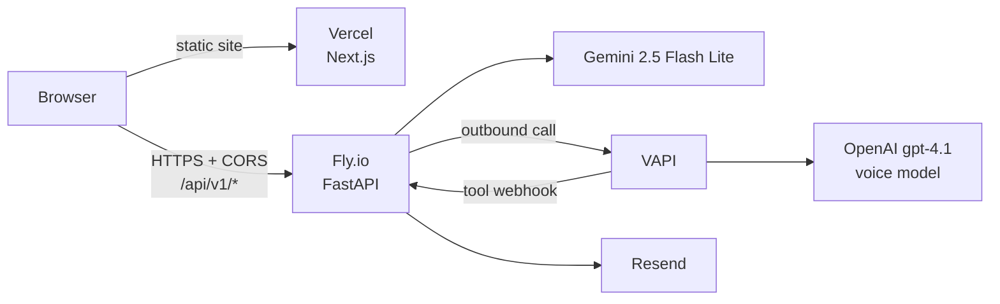

# Elara.ai — AI Patient Assistant

A full-stack AI medical assistant that helps patients schedule appointments, manage prescriptions, and get practice information through natural conversation with one-click voice handoff.

Built in 4 days.

**[Live Demo](https://elara-ai-frontend-5hst.vercel.app)** · **[API](https://backend-purple-pine-3154.fly.dev)**

---

## What It Does

- **Smart Scheduling** — Matches body part to the right specialist, filters by day/time preference, books the appointment
- **Natural Conversation** — Patients provide details naturally ("I'm John Smith, 9296694178, john@gmail.com") and the LLM extracts everything at once
- **Mid-Flow Q&A** — Ask "what should I bring?" while booking and get a real answer, not "invalid input"
- **Post-Booking Guidance** — Personalized prep tips based on specialty and body part
- **Voice Handoff** — One click to continue the conversation as a phone call, full context preserved
- **Email Confirmations** — Sent from a custom domain via Resend
- **Prescription Refills** — Guided medication and pharmacy collection
- **Practice Info** — Hours, address, contact details
- **Safety** — No medical advice, no diagnosis, validated inputs, graceful degradation

---

## Architecture



The browser talks to the FastAPI backend on Fly.io **directly over HTTPS**; there is no proxy hop. The backend allows the Vercel origins through CORS (`backend/app/main.py`), and the frontend reads the backend URL from `NEXT_PUBLIC_API_BASE_URL` at build time.

Session state currently lives in backend memory, so it is cleared whenever the Fly machine restarts or stops. The frontend recovers automatically (the backend answers `404 {"error": "session_expired"}` and the chat starts a fresh session). Full details are in [ARCHITECTURE.md](./ARCHITECTURE.md).

---

## Tech Stack

| Layer | Technology |
|-------|-----------|
| Frontend | Next.js 16, React 19, TypeScript, Tailwind CSS 4 |
| Backend | FastAPI, Python, Pydantic |
| LLM | Google Gemini 2.5 Flash Lite |
| Hosting | Docker on Fly.io (`backend/fly.toml`, HTTPS terminated by Fly) |
| Voice | VAPI (call model: OpenAI `gpt-4.1`, configured in `voice_prompt.py`) |
| Email | Resend + custom domain |
| Deploy | Vercel (frontend), `fly deploy` (backend) |

---

## LLM Design

Five Gemini functions (`backend/app/services/llm_service.py`), each with a specific purpose and a fallback if the AI is unavailable. Every call is async with a timeout (`LLM_TIMEOUT_SECONDS`, default 15 s), and failures are logged and fall back.

| Function | What It Does | Fallback |
|----------|-------------|----------|
| `extract_structured_intent` | Routes patient to the right workflow | Keyword matching |
| `generate_chat_reply` (reply polish) | Makes responses sound human | Original template |
| `extract_intake_fields` | Parses name, DOB, phone, email from one message | One-at-a-time prompts |
| `generate_post_booking_guidance` | Personalized prep tips after confirmation | Skipped gracefully |
| `generate_general_reply` | Answers mid-flow questions ("what should I bring?") and off-topic chat, then steers back to the flow | Canned prompt for the current step |

Gemini is only used when `LLM_ENABLED=true` and `GEMINI_API_KEY` is set; otherwise the app runs on the keyword fallbacks. The phone assistant is separate: VAPI runs OpenAI `gpt-4.1` and calls back into the backend through tool webhooks.

---

## Providers

| Doctor | Specialty | Treats |
|--------|----------|--------|
| Dr. Sarah Chen | Orthopedics | Knee, leg, ankle |
| Dr. Michael Rivera | Spine Care | Back, neck, spine |
| Dr. Emily Patel | Sports Medicine | Shoulder, arm, elbow, wrist |
| Dr. James Wilson | Dermatology | Skin, rash, scalp |

Unsupported concerns (eye, dental, ear) are explicitly rejected with a helpful message.

---

## Quick Start

**Backend**
```bash
cd backend
cp .env.example .env        # then fill in values; see the comments in the file
pip install -r requirements.txt
uvicorn app.main:app --reload --port 8000
```
All configuration comes from environment variables listed in [`backend/.env.example`](./backend/.env.example) (Gemini, VAPI, Resend, public URLs). Without keys the app still runs, using keyword fallbacks and skipping voice and email.

**Frontend**
```bash
cd frontend
echo "NEXT_PUBLIC_API_BASE_URL=http://localhost:8000" > .env.local
npm install && npm run dev
```

**Tests (backend)**
```bash
cd backend
pip install -r requirements-dev.txt
pytest
```

## Deploying

- **Backend:** `cd backend && fly deploy`. Set secrets with `fly secrets set GEMINI_API_KEY=... LLM_ENABLED=true VAPI_API_KEY=... VAPI_PHONE_NUMBER_ID=... RESEND_API_KEY=... PUBLIC_BACKEND_BASE_URL=https://backend-purple-pine-3154.fly.dev`. Never commit secret values.
- **Frontend:** Vercel, with `NEXT_PUBLIC_API_BASE_URL=https://backend-purple-pine-3154.fly.dev` set for each environment. It is read at build time, so redeploy after changing it.

---

## Design Principles

- Graceful Degradation — Every LLM call has a fallback. App works without AI.
- Production Thinking — HTTPS everywhere. Input validation. No medical advice. Resilient client (timeouts, retries, session recovery).
- Cost Efficiency — Small, fast model (Gemini 2.5 Flash Lite) and a single small Fly machine that stops when idle.
- Scalability Path — In-memory sessions to Postgres/Redis, then more Fly machines. No rewrite needed.
